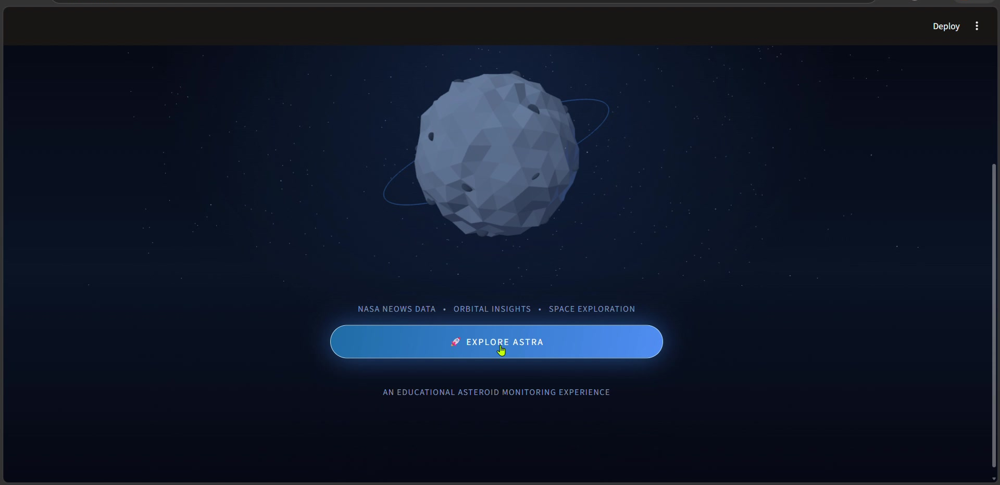
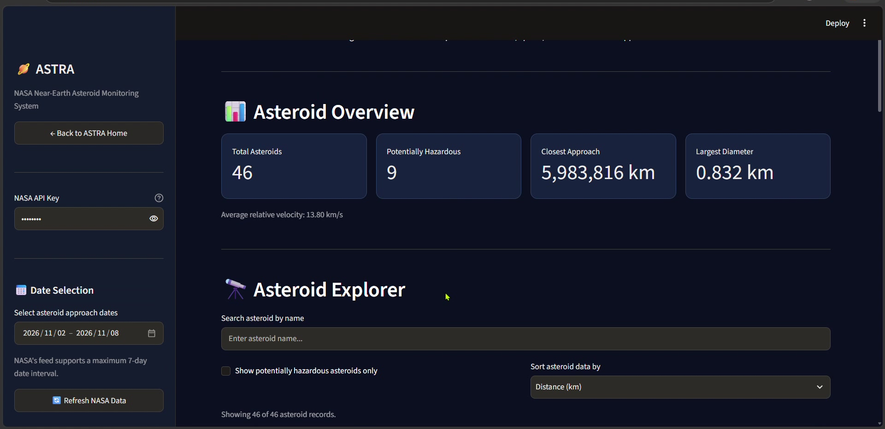
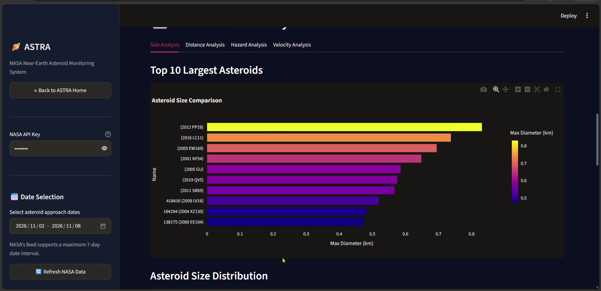

# ASTRA – Near-Earth Asteroid Monitoring Dashboard

ASTRA is a web-based asteroid monitoring dashboard that uses NASA's Near-Earth Object (NEO) API to retrieve and visualize information about asteroids approaching Earth.

## Features

- Fetches asteroid data using NASA's NeoWs API.
- Displays asteroid monitoring statistics.
- Identifies potentially hazardous asteroids.
- Search, filter, and sort asteroid records.
- Interactive charts and visualizations.
- Individual asteroid profile and NASA lookup.
- Download asteroid data as CSV.
- Interactive 3D asteroid landing page.

## Technologies Used

- Python
- Streamlit
- Pandas
- Plotly
- Requests
- NASA NeoWs API
- Three.js

## Project Structure

```text
ASTRA/
├── app.py
├── app_astra_upgraded.py
├── requirements.txt
├── README.md
├── .gitignore
├── services/
│   ├── __init__.py
│   └── nasa_api.py
├── utils/
│   ├── __init__.py
│   └── data_processor.py
├── tests/
│   └── test_data_processor.py
└── assets/
```

## Installation and Setup

### 1. Clone the repository

```bash
git clone YOUR_GITHUB_REPOSITORY_URL
cd ASTRA
```

### 2. Create a virtual environment

```bash
python -m venv venv
```

### 3. Activate the environment

Windows PowerShell:

```powershell
.\venv\Scripts\Activate.ps1
```

### 4. Install dependencies

```bash
python -m pip install -r requirements.txt
```

### 5. Run ASTRA

```bash
python -m streamlit run app_astra_upgraded.py
```

## NASA API

ASTRA uses NASA's Near Earth Object Web Service (NeoWs).

API documentation:
https://api.nasa.gov/

The application supports NASA's demonstration API key. A personal API key can also be used.

## Run Tests

```bash
python -m pytest
```

## Purpose

This project was developed to explore API integration, data processing, data visualization, and interactive dashboard development using Python.
## Screenshots

### ASTRA Landing Page


### Dashboard Overview


### Analytics
